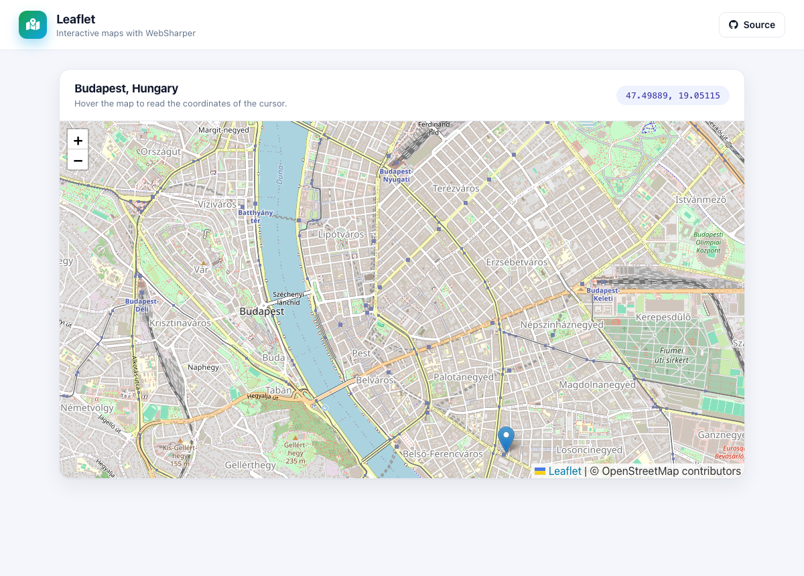

# WebSharper Leaflet

An interactive [OpenStreetMap](https://www.openstreetmap.org/) map built with
[WebSharper](https://websharper.com) and the
[WebSharper.Leaflet](https://github.com/dotnet-websharper/leaflet) bindings — a
map centered on Budapest with a marker, and a live readout of the cursor's
coordinates.

[](https://websharper-samples.github.io/Leaflet)

**[Try it live](https://websharper-samples.github.io/Leaflet)**

## How it works

- `src/Client.fs` builds a `Leaflet.Map` on the map container, adds an
  OpenStreetMap tile layer and a marker (with a popup), and wires the map's
  `mousemove` / `mouseout` events to a `Var` that drives the coordinate readout.
- `src/wwwroot/index.html` is the whole page — the header, the card and the map
  container — bound with `.Bind()`, so there is no mount point.

Leaflet itself (JS and CSS) is loaded from a CDN in `index.html`.

## Running locally

```
dotnet run --project src
```

Then open <http://localhost:5586>.

## Building

```
dotnet build src/Leaflet.fsproj -c Release
```

WebSharper compiles the client and [esbuild](https://esbuild.github.io/) bundles
it into `src/wwwroot/Scripts`.

## Deployment

Every push to `master` builds in Release and publishes `src/wwwroot` to the
`gh-pages` branch via `.github/workflows/deploy.yml`.
